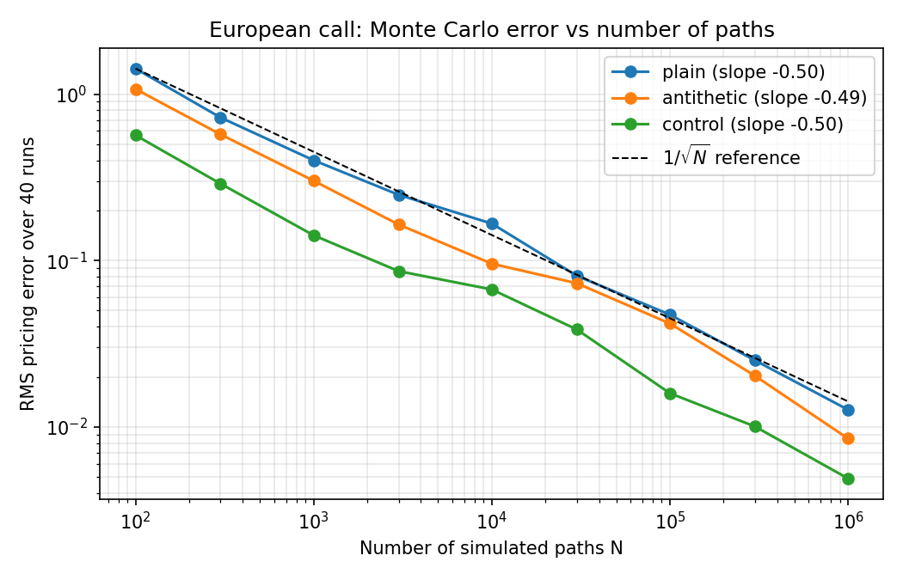

# Monte Carlo Option Pricing with Variance Reduction

Prices options by simulating thousands of possible stock price paths and
averaging the payoffs. It checks every estimate against the exact
Black-Scholes answer and measures how much three variance reduction
techniques improve precision.

**Main results** (S0 = 100, K = 100, T = 1 year, r = 5%, sigma = 20%; full tables in [results/results.md](results/results.md)):

- European call: Monte Carlo prices match the Black-Scholes price of **10.4506** within their 95% confidence intervals.
- Error falls like **1/sqrt(N)**. The fitted log-log slope is -0.50, against a theoretical -0.5.
- The 95% confidence intervals are honest: they contained the true price in **95.2%** of 1,000 independent runs.
- **Control variate** on a European call: **6.8x** variance reduction. Antithetic sampling: **2.0x**.
- **Arithmetic Asian call** (no closed form): a geometric-average control variate gives **~1,265x** variance reduction.
- Pathwise **delta** estimate 0.6370 +/- 0.0025 against Black-Scholes 0.6368.



## The idea

Under the Black-Scholes model, the risk-neutral stock price at time T is

```
S_T = S0 * exp((r - sigma^2 / 2) T + sigma sqrt(T) Z),   Z ~ Normal(0, 1)
```

An option's price is the discounted expected payoff, `e^{-rT} E[payoff(S_T)]`.
Monte Carlo estimates that expectation with a sample mean over N simulated Z values.

By the Central Limit Theorem the sample mean is approximately normal with standard error
`s / sqrt(N)`, where s is the sample standard deviation of the payoffs. This gives:

- **A confidence interval** for free: price +/- 1.96 x standard error.
- **Slow convergence**: halving the error needs **4x** the paths.

So instead of adding paths, it is often better to reduce `s`. That is variance reduction.

## Variance reduction methods

| Method | How it works | Why it helps |
| --- | --- | --- |
| Antithetic variates | For every Z, also use -Z. | For a monotone payoff, a high outcome from Z pairs with a low one from -Z, so their average varies less. The pairs are dependent, so the standard error is computed from the pair averages. |
| Control variate (European) | Also record X = e^{-rT} S_T, whose mean is known to be S0. Use Y - b (X - S0), with b = Cov(Y, X) / Var(X). | When the simulated stock ends high, the payoff is usually high too. Subtracting the known error in X cancels much of the error in Y. That b minimises the variance. |
| Control variate (Asian) | The geometric-average Asian option has an exact formula, and its payoff is almost perfectly correlated with the arithmetic one. | The closer the correlation is to 1, the bigger the reduction: the variance is multiplied by (1 - rho^2). |

## Delta by the pathwise method

Delta is how much the option price changes when S0 changes. Differentiating
the discounted call payoff with respect to S0, and using `dS_T/dS0 = S_T/S0`, gives

```
delta estimate = e^{-rT} * 1{S_T > K} * S_T / S0
```

averaged over paths. It needs no re-simulation and no finite-difference bump.

## Project layout

```
mcoptions/
  black_scholes.py   exact prices: Black-Scholes call/put/delta, geometric Asian call
  simulate.py        GBM simulation (exact solution, so no time-stepping error)
  pricers.py         Monte Carlo pricers returning price + standard error
tests/
  test_pricers.py    12 tests: each MC estimate must land within 4 standard errors of the exact answer
run_experiments.py   regenerates results/results.md and both plots
```

## Run it

```bash
python3 -m venv .venv
source .venv/bin/activate
pip install -r requirements.txt
pytest                     # 12 tests
python run_experiments.py  # writes results/ (about 15 seconds)
```

Results are reproducible because every run uses a fixed random seed.

## Possible extensions

- Quasi-Monte Carlo (Sobol sequences), which can converge closer to 1/N.
- Barrier options, where path monitoring creates a time-stepping bias.
- Stochastic volatility, e.g. the Heston model.
