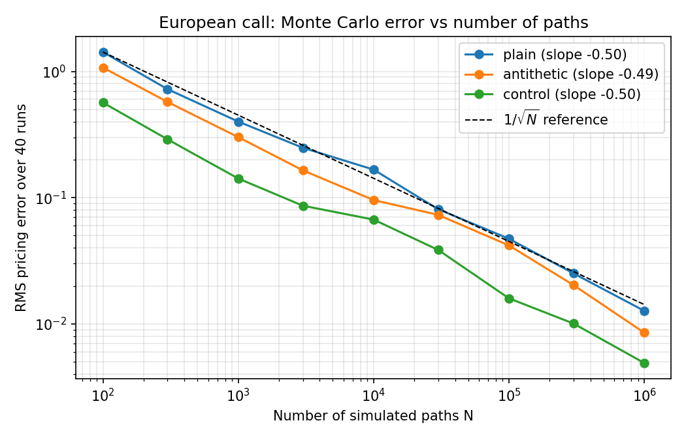
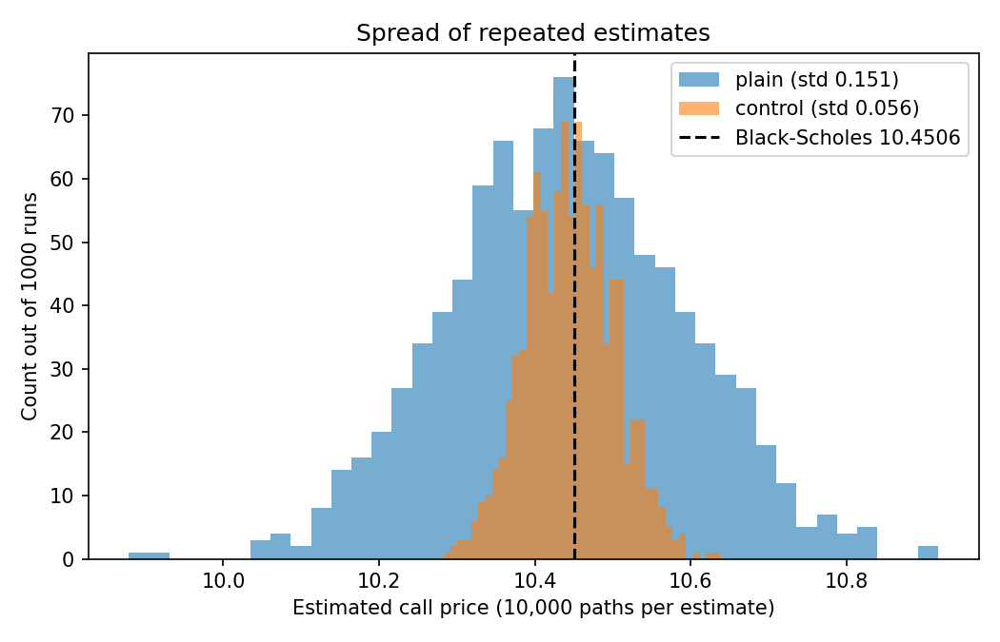

# Results

Parameters: S0 = 100.0, K = 100.0, T = 1.0 year, r = 0.05, sigma = 0.2.
Generated by `python run_experiments.py`.

## 1. European call: Monte Carlo vs Black-Scholes

Black-Scholes price: **10.4506**. Each row uses 100,000 paths.

| Method | MC price | Std error | 95% CI | Abs error | Variance reduction |
| --- | --- | --- | --- | --- | --- |
| plain | 10.4205 | 0.0468 | [10.3289, 10.5122] | 0.0300 | 1.0x |
| antithetic | 10.4673 | 0.0331 | [10.4025, 10.5321] | 0.0167 | 2.0x |
| control | 10.4668 | 0.0179 | [10.4318, 10.5019] | 0.0163 | 6.8x |

Variance reduction = (plain std error / method std error)^2, i.e. how many times
more plain paths you would need for the same precision.

## 2. Convergence

Fitted log-log slopes of RMS error against N: plain -0.497, antithetic -0.494, control -0.496.
Theory says -0.5 (error proportional to 1/sqrt(N)).

## 3. Do the confidence intervals mean what they say?

Over 1,000 independent runs of 10,000 paths, the 95% confidence interval
contained the true price **95.2%** of the time.

## 4. Delta

Pathwise delta (200,000 paths): **0.6370** +/- 0.0025 (95%), Black-Scholes delta: **0.6368**.

## 5. Asian option (no closed form)

Arithmetic Asian call, weekly averaging (52 dates), 100,000 paths:

| Method | MC price | Std error | Variance reduction |
| --- | --- | --- | --- |
| plain | 5.8997 | 0.0257 | 1.0x |
| geometric control variate | 5.8535 | 0.00072 | 1,265x |
